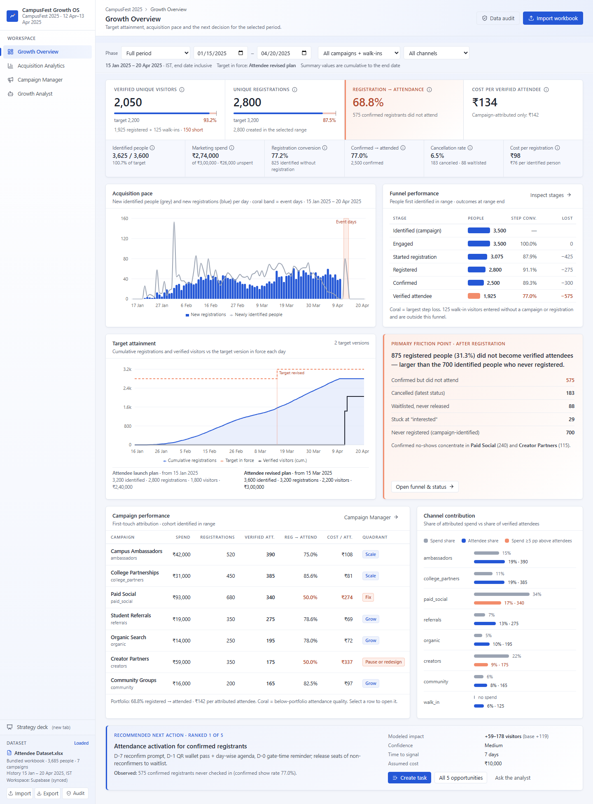

# CampusFest Growth OS

**Risa Labs Growth APM — Challenge A: Attendee Growth.** This is a working growth-intelligence product and a 3-slide strategy deck. Both are built on `Attendee Dataset.xlsx`, and every number in either one is computed from that workbook at run time.

| Deliverable | Location |
|---|---|
| Working product (React + TypeScript + Vite) | [`app/`](app/) |
| 3-slide strategy deck: PDF | [`deliverables/CampusFest_Growth_Strategy_3_slides.pdf`](deliverables/CampusFest_Growth_Strategy_3_slides.pdf) |
| 3-slide strategy deck: live HTML (same analytics code) | `app/deck.html` (open `/deck.html` on the dev server) |
| Design reference (from the two selected decks) | [`docs/design-reference.md`](docs/design-reference.md) |
| Screenshots | [`docs/screenshots/`](docs/screenshots/) |
| Independent KPI check (pandas) | [`scripts/validate_workbook.py`](scripts/validate_workbook.py) |
| Optional Supabase schema | [`supabase/schema.sql`](supabase/schema.sql) |
| Source workbook (unchanged copy) | [`data/Attendee Dataset.xlsx`](data/) and `app/public/data/` |



More screens: [Analytics: funnel](docs/screenshots/analytics.png) · [campaigns](docs/screenshots/analytics-campaigns.png) · [cohorts](docs/screenshots/analytics-cohorts.png) · [strategy](docs/screenshots/analytics-strategy.png) · [Campaign Manager](docs/screenshots/campaigns.png) · [Growth Analyst](docs/screenshots/analyst.png) · [Data audit](docs/screenshots/data.png) · 900 px: [overview](docs/screenshots/overview-narrow.png), [analytics](docs/screenshots/analytics-narrow.png), [campaigns](docs/screenshots/campaigns-narrow.png), [analyst](docs/screenshots/analyst-narrow.png)

---

## 1. Product overview

CampusFest Growth OS is the command centre an event-growth manager uses to answer five questions:

1. **Are we on track?** KPIs against the target version in force on the selected date, with a run-rate projection before the event.
2. **Which audiences and campaigns produce valuable attendees?** Cost per *verified attendee*, not per click or registration.
3. **Where do people drop off?** A cohort funnel from identified person to verified attendee, with anonymous awareness shown separately.
4. **What should we do next?** Five prioritised opportunities. Each has measured evidence, labelled assumptions, an experiment design and scale / change / stop thresholds.
5. **How do we execute?** Campaign Manager (plan, launch locally, log results, run experiments, track tasks) plus an embedded Growth Analyst that turns answers into actions after the user confirms them.

**Application shell**

- **Left sidebar:** product name, event and dates, the four primary pages, a Strategy deck link, and a dataset block.
- **Dataset block:** file name, rows, history range and storage location, plus **Import**, **Export** and **Audit**.
- **Export options:** campaign performance CSV for the current filters, or a workspace JSON backup.
- **Top bar:** breadcrumb, page title and description, and **Import workbook**.
- **Shared filter row:** sticky on Overview and Analytics. Controls are phase, date range, campaign and channel. Phases are derived from the workbook: full period, each target plan, pre-event, event days, post-event.
- **Filter context:** active-filter chips each have their own clear plus Clear all. The row also shows the reporting period and the target version in force.

| Screen | What it does |
|---|---|
| **Growth Overview** | A primary summary strip (verified visitors and registrations vs target, registration → attendance, cost per verified attendee) above six secondary metrics. Below that: acquisition pace, the funnel table, target attainment (step at the target revision), the **primary friction point**, the campaign ledger, channel contribution (spend share vs attendee share), and the recommended next action with Create task. Every metric has a definition on hover. |
| **Acquisition Analytics** | Four URL-addressable tabs. **Funnel & Status:** funnel with a stage inspector (numerator, denominator, conversion, people lost, per-campaign split), anonymous awareness counts, cumulative progress vs target, daily status changes, status distribution. **Campaigns & Spend:** campaign matrix, quadrant decisions, conversion-rate table, spend-efficiency ranking, spend vs outcome share, channel comparison. **Cohorts & Quality:** engagement signals (did vs didn't), registration timing, attendance quality, recovery pools. **Prioritized Strategy:** baseline / base / range, ranked opportunities with evidence, assumptions and decision rules, proposed budget allocation, deprioritized ideas. |
| **Campaign Manager** | A budget summary strip and a searchable, filterable table of workbook campaigns and local simulations (source, status, proposed budget, spend, key signal). Selecting a row opens a detail pane. The pane groups actions (Edit / Edit plan, Launch simulation, Pause / Resume, Complete, Archive / Restore, all confirmed) and shows observed performance, budget vs spend, target, experiment plan (hypothesis, leading indicator, scale and stop rules), linked experiments, and simulated results. Further tabs hold experiments, tasks and the activity log. |
| **Growth Analyst** | A context panel shows the as-of date with presets, target in force, key observed metrics at that date, carried follow-up context, and the answer-engine status. Each answer is laid out as conclusion → supporting metrics → interpretation (observed / forecast or hypothesis / data limits) → recommended next step → source metrics. Any action that changes state needs confirmation. Suggested questions are grouped by topic. |
| **Data audit** | Workbook audit (rows read, rows used, duplicates removed), data-quality findings and how each is handled, metric definitions, dated targets, workbook replacement, workspace reset. |

UI design notes, the before/after inspection, and the reference patterns adapted are in [`docs/ui-redesign-notes.md`](docs/ui-redesign-notes.md).

## 2. Problem statement

CampusFest 2025 (fictional, 12–13 Apr 2025, data 15 Jan – 20 Apr 2025) is measured against a revised plan: 3,600 identified external people, 3,200 registrations, 2,200 unique external visitors and a ₹3,00,000 budget. The goal is to maximise **actual verified attendance** within that budget, not registrations or reach.

## 3. Product strategy and key findings

All figures are computed by the app and match the independent pandas check.

| Metric (as of 20 Apr 2025, revised plan) | Actual | Target | Attainment |
|---|---|---|---|
| Identified external people | 3,625 | 3,600 | 100.7% |
| Unique registrations | 2,800 | 3,200 | 87.5% |
| Verified unique external visitors | 2,050 (1,925 registered + 125 walk-ins) | 2,200 | 93.2% |
| Net marketing spend | ₹2,74,000 | ₹3,00,000 | 91.3% |
| Registration conversion (reg ÷ identified) | 77.2% | | |
| Registration → attendance | 68.8% (confirmed → attended 77.0%) | | |
| Cancellation rate (latest status) | 6.5% | | |
| Cost per identified / registration / verified attendee | ₹76 / ₹98 / ₹134 (₹142 per campaign-attributed attendee) | | |

**Insights**

- **The largest leak comes after registration.** 875 registered people (31.3%) never became verified attendees: 575 confirmed no-shows, 183 cancelled, 88 waitlisted and never released, 29 stuck at "interested". Only 700 identified people were lost before registering.
- **The identified-people target was met only because of walk-ins.** On the day before the event the count was 3,500 (97.2%). 125 walk-ins identified at the gate pushed it over 3,600.
- **Spend went to the wrong audiences.** Paid Social and Creator Partners took 55% of spend but delivered 27% of attributed attendees, with a 50% registration → attendance rate against 69% for the portfolio. Cost per verified attendee was ₹274 and ₹337, against ₹69–₹108 for the other five campaigns.
- **Matrix result** (volume = registrations vs portfolio average; quality = show rate vs portfolio):
  - Scale: Campus Ambassadors, College Partnerships.
  - Grow: Student Referrals, Organic Search, Community Groups.
  - Fix: Paid Social.
  - Pause or redesign: Creator Partners.
- **Behaviour signals** (associations, not causal effects):
  - Brochure downloaders who registered attended at 74.7%, against 61.9% for those who did not download.
  - Registrants 31–60 days before the event attended least (63.1%).
  - Nurture emails went almost only to unregistered people, so their lower conversion reflects targeting, not an email effect.
- **Recovery pools:**
  - 275 form abandoners, of whom 115 are contactable (not opted out).
  - 88 waitlisted registrants.
  - 60 confirmed registrants lost at the gate (denied or pending, never admitted).

**Strategy: maximise verified attendance.** Five ranked bets. Impact is the *modeled* number of extra verified attendees; assumptions are shown in the app.

| # | Bet | Low–high (base) | Confidence | Assumed cost |
|---|---|---|---|---|
| 1 | O1 Attendance activation for confirmed registrants (D-7 reconfirm, D-1 QR pass and agenda, D-0 reminder; 80/20 holdout) | +59–178 (+119) | Medium | ₹10,000 |
| 2 | O2 Shift budget to attendance-efficient campaigns (Creator −50%, Paid Social −20%, to Referrals / Organic / College; staged 25%) | +44–363 (+163) | Low | ₹7,000 unspent |
| 3 | O4 Release the waitlist in waves against forecast no-shows (capacity-capped) | +34–68 (+51) | Medium | ₹2,000 |
| 4 | O3 Recover abandoned and stalled registrations (saved-form link, A/B) | +10–30 (+20) | Medium | ₹2,000 |
| 5 | O5 Remove gate friction (QR pre-check, help-desk lane) | +15–45 (+30) | Low | ₹5,000 |

**Outcome range:**

- Base case: 2,433 verified visitors (+18.7%).
- Low case: 2,212.
- Stretch: 2,734.
- Same ₹3,00,000 budget; the proposed allocation sums exactly to the budget.

**Deliberately not funded:**

- Scaling Paid Social reach.
- Re-funding Creator Partners as it is.
- Blanket nurture email to every lead.

## 4. Target users

- **Event-growth manager (primary):** monitors targets, reallocates budget, decides what to scale or stop.
- **Campaign owners** (four owners in the workbook): run campaigns, log results, own tasks.
- **Festival lead / reviewer:** reads the Overview and the deck.

## 5. Dataset structure

The workbook has 11 sheets. Rows read are listed below, with the rows used after de-duplicating on stable IDs.

| Sheet | Rows read → used | Key | Notes |
|---|---|---|---|
| Read me, Field guide | 8, 86 | n/a | Read in full; rules applied below |
| Event | 1 | n/a | 12–13 Apr 2025, Asia/Kolkata, INR, fictional |
| Targets | 2 | `effective_at` | Launch plan (15 Jan) → revised plan (15 Mar 2025 09:00 IST) |
| Campaigns | 7 | `campaign_id` | One channel per campaign |
| Daily Marketing | 483 → 481 | `activity_id` | 2 import repeats; 4 negative (credit) rows; anonymous counts |
| People | 3,685 | `person_id` | 3,625 external, 40 internal, 10 staff, 10 test; 3 shared names |
| Interest and Engagement | 11,650 | `interaction_id` | 8 identified action types |
| Registrations | 2,840 | `registration_id` | 2,800 external + 40 internal; one registration per person |
| Registration History | 5,911 → 5,907 | `history_id` | 4 import repeats; full-state versions |
| Check-ins | 3,390 → 3,370 | `event_id` | 20 repeats; 3,290 admitted + verified events from 2,090 people (2,050 external) |

## 6. Data cleaning and joining methodology

1. **Read the workbook directly** in the browser with SheetJS. The source file is never modified, and a replacement upload is stored separately.
2. **Time zone.** Every timestamp is treated as IST wall time and stored on a UTC time line, so day boundaries never depend on the viewer's browser. A selected date means the end of that day in IST.
3. **De-duplication.** Exact repeats of a stable ID count once. A repeated ID with *different* content is kept once and flagged; the workbook has none.
4. **Validation.** Required sheets and columns are checked. Rows missing IDs or timestamps are excluded and counted, never imputed. Other checks: orphan foreign keys, history before registration, timestamp ties, check-ins outside event days, check-in/registration person mismatch.
5. **Joins** use `person_id`, `registration_id` and `campaign_id` only. Names are display labels.
6. **Person-level model.** For each external person the model holds:
   - first seen and first-touch campaign
   - registration with its sorted status history
   - first verified admission, admission events, days attended, manual-only flag
   - gate issues
   - first time of each interaction type
7. **Status at a date** is the latest history version with `effective_at` at or before the end of that day. Re-confirmation updates the same registration and never adds a person.
8. **Verified attendance** means at least one check-in with `result = admitted` and `verification = verified`. Denied, pending and unverified rows never count on their own. Repeat admissions are the same person.
9. **External only.** Internal, staff and test records are excluded from acquisition metrics and reported separately.

## 7. Metric definitions

These definitions are used identically in the app, the analyst and the deck.

| Metric | Definition |
|---|---|
| Identified external people | Distinct external `person_id` with `first_seen_at` ≤ end of day (includes walk-ins) |
| Unique registrations | Distinct external `person_id` with a registration created ≤ end of day |
| Confirmed / cancelled / waitlisted / interested | Latest status version at the date |
| Cancellation rate | Latest status = cancelled ÷ registrations |
| Verified unique visitors | Distinct external `person_id` with ≥1 admitted + verified check-in |
| Verified attendees (registered) | Registered people among verified visitors (campaign-creditable) |
| Registration conversion | Registrations ÷ identified external people |
| Registration → attendance | Registered verified attendees ÷ registrations |
| Net spend | Σ `marketing_spend_inr` (debits − credits), de-duplicated, by posting date |
| Cost per identified / registration / verified attendee | Cumulative net spend ÷ the matching distinct-person count |
| Target in force | Target row with the latest `effective_at` ≤ end of day |
| Cohort views (funnel, campaign table) | People first identified in the range; outcomes measured at range end |
| Cumulative vs in-range | KPI cards are cumulative to the end date; "new in range" counts flows inside the range |

## 8. Analytics assumptions and attribution

- **Attribution is first touch** (`People.first_campaign_id`). It is identical to `Registrations.campaign_id` for every registration (checked). It records a source relationship, not causal impact.
- **Walk-ins have no campaign.** Their acquisition cost is *unknown*, not zero. The blended cost per visitor includes them in the denominator; the campaign-attributed figure excludes them.
- **Anonymous counts are never added to person counts.** These are impressions, clicks, reach, sessions and form starts. Reach is not summed into unique people.
- **Targets apply by date.** Before 15 Mar 2025 09:00 IST the launch plan applies, and from then the revised plan. Charts step the target line on that date.
- **Pre-event projection** extends the linear run-rate of the last 14 days to the day before the event. It is labelled as modeled.
- **Opportunity model.** Every modeled number is derived from observed rates with explicit assumptions:
  - The share of the gap closed (25 / 50 / 75%).
  - Marginal cost of extra spend = 1.5–3× the observed average cost.
  - Recovery rates of 10–30%.
  - A 70% show-up assumption before attendance exists.
  - Priority = base impact × confidence (1 / 0.7 / 0.4) ÷ effort (1 / 1.5 / 2.5) ÷ (1 + days-to-signal ÷ 30).
- **Capacity** is not in the workbook. Waitlist release is conditional on real capacity.

## 9. Product architecture

```
Attendee Dataset.xlsx ──► data/loadWorkbook.ts   (SheetJS parse, schema checks, ID de-dup, IST times, audit)
                      ──► analytics/model.ts     (stable-ID joins → person facts, data-quality findings)
                      ──► analytics/metrics.ts   (snapshot, funnel, campaigns, channels, trend, segments, quality, pools)
                      ──► analytics/opportunities.ts (bottleneck, 5 opportunities, deprioritised, budget allocation)
                      ──► analytics/segments.ts  (audience segments for campaign targeting)
        ├── pages/* (Overview, Analytics, Campaign Manager, Analyst, Data) — presentation only
        ├── analyst/engine.ts (intent router over the functions above) + analyst/gemini.ts (optional)
        ├── deck/Deck.tsx (3 slides, same functions, inline SVG)
        └── store/workspace.ts (local campaigns, overlays, experiments, tasks, activity)
                 └── localStorage always · store/supabase.ts when configured
api/analyst.ts (Vercel function) + api/_gemini.ts — Gemini call with the key on the server only
```

Calculations live only in `src/analytics`. Pages hold no KPI logic and no hardcoded values.

**Stack and tools.** All are free tier.

| Area | Tools |
|---|---|
| App | React 19, TypeScript, Vite 8, Tailwind CSS 4, Recharts 3, lucide-react |
| Data | SheetJS `xlsx` 0.18.5 from npm, used only for local files |
| Persistence | `@supabase/supabase-js` (optional) |
| Hosting and AI | Vercel Hobby; Google AI Studio Gemini API free tier (optional) |
| Verification | `tsx` for the verification scripts; Python with pandas and PyMuPDF for the independent check and PDF review |
| Deck export | Headless Chrome / Edge |

**Colour system.** Cobalt `#2457D6` is the primary colour and coral `#F28C6B` is the only accent. The palette was validated for colour-vision deficiency. Details are in `docs/design-reference.md`.

## 10. AI analyst implementation

- **Local engine** (`src/analyst/engine.ts`). It parses entities (campaign names and aliases, channels, local campaign names), dates ("as of 31 March", "in February", "before the event", "last week") and metrics (16). It routes to 25+ analysis handlers:
  - targets and run-rate, funnel, budget, pause / redesign, channel, next 7 days
  - opportunities, what we would not fund, compare, campaign profile, what-if budget shifts, metric lookup
  - engagement signals, timing, no-shows and gate quality, status
  - local campaigns, tasks, definitions, data quality
  - follow-ups: "why?", "how confident?", "break it down"
- **Response structure.** Every response has: summary, facts, evidence table, observed facts, hypotheses / model, data limits, metrics used, date range, confidence, actions and follow-ups.
- **Context.** The last answer and its focus campaigns carry into follow-ups ("why?", "and creator partners?").
- **Honesty.**
  - Questions outside the data are answered with "the workbook cannot answer this" plus what *is* available. This covers demographics, colleges, city, revenue, sponsorship, satisfaction, capacity, no-show reasons, other editions and creatives.
  - Unrecognised questions get "I could not map that…". The analyst never guesses a number.
  - Before the event, attendance metrics are reported as not measurable.
- **Execution.** Actions open a confirmation step before anything changes:
  - campaign drafts open the editable campaign form
  - tasks and plan-status changes open a confirm dialog
  - "Open campaign" navigates to the campaign
  - Applied actions are marked as applied and logged.
- **Answer-as-of date.** Setting a pre-event date gives pre-event advice and projections.
- **Optional Gemini (free tier).** When `GEMINI_API_KEY` is set on the server:
  - Gemini rewrites the local answer into a short narrative.
  - It receives the computed answer and a compact data pack, and is instructed to use only those numbers.
  - The client runs a grounding check and flags any number in the narration that does not appear in the supplied data.
  - The key is never sent to the browser: calls go through `api/analyst.ts` (Vercel) or the Vite dev middleware.
- **Tests.** `npm run test:analyst` runs 30 questions, including follow-ups and unanswerable ones.

## 11. Campaign Manager functionality

**Campaigns**
- **Source vs local.** Source campaigns are labelled *workbook · read-only results*. Local campaigns are labelled *created in this app · simulation*.
- **Source campaigns:**
  - plan status (active / paused / archived / completed)
  - proposed budget vs actual spend
  - notes
  - draft a follow-up campaign
  - record an experiment
  - ask the analyst
- **Local campaign form:**
  - name, owner, channel (source channels or new ones)
  - audience segment from workbook-defined segments, shown with live sizes
  - objective, proposed budget, start and end dates
  - target metric and value
  - notes
- **Local campaign lifecycle:** save draft → launch (local) → pause / resume → complete → archive / restore.
- **Results and budget.** Log results (spend, registrations, attendees) per local campaign; budget used and cost per attendee are computed from them. Draft and active proposed budgets are compared with the unspent approved budget.

**Experiments and tasks**
- **Experiments:** hypothesis, metric, control and variant, dates, status, control and variant results, difference, decision (scale / change / stop), learning.
- **Tasks:** owner, due date, linked campaign, status, overdue flag. Tasks are created manually or from the analyst.
- **Activity log:** every change is recorded.
- **No real sends.** Launching never sends emails, posts or ads. This is stated in the form.

**Persistence**
- The workspace is saved in localStorage and survives reloads (tested).
- With Supabase configured, it also syncs to the `workspace_state` table, with a debounced upsert and newest-wins on load.

## 12. Setup and execution

**Prerequisites:** Node 20+ (tested on 24) and npm. Python 3 with pandas is needed only for the optional independent check.

Install dependencies and start the dev server:

```powershell
cd app
```

```powershell
npm install
```

```powershell
npm run dev
```

Then open:

- the app: http://localhost:5173
- the deck: http://localhost:5173/deck.html (append `?name=Your%20Name&city=Bengaluru` to set the author line)

Other commands:

| Command | What it does |
|---|---|
| `npm run build` | Type-check and production build to `app/dist` (two entries: app and deck) |
| `npm run preview` | Serve the production build |
| `npm run verify` | Print KPIs computed by the app's own modules (optionally pass another workbook path) |
| `npm run test:analyst` | Run the analyst question battery |
| `npm run deck:pdf` | Export the 3-slide PDF to `deliverables/` (dev server must be running; uses local Chrome / Edge) |
| `node scripts/screenshots.mjs` | Regenerate README screenshots |
| `python scripts/validate_workbook.py` | Independent pandas check, run from the repository root |

**Optional configuration** (copy `app/.env.example` to `app/.env.local`):
- `GEMINI_API_KEY`: a free key from Google AI Studio, which enables Gemini narration. `GEMINI_MODEL` defaults to `gemini-3.8-flash`.
- `VITE_SUPABASE_URL` and `VITE_SUPABASE_ANON_KEY`: create a free Supabase project and run `supabase/schema.sql` in its SQL editor first.

**Deploy to Vercel (Hobby, free):**
1. Push the repository to GitHub.
2. In Vercel, choose **New Project**, import the repository and set **Root Directory = `app`**. The framework is detected as Vite; `app/vercel.json` sets build and output.
3. Optionally add `GEMINI_API_KEY` and the Supabase variables under Environment Variables.
4. Deploy. `api/analyst.ts` becomes a serverless function automatically. `/deck` rewrites to the deck.

**Changing the data.** Choose **Import workbook** (top bar or sidebar). A replacement with the same sheets and columns recomputes every KPI, chart, opportunity, budget line and analyst answer. Invalid files are rejected with a specific message, and the previous data stays loaded.

## 13. Known limitations

- **Data limits.** One synthetic edition only. There are no demographics, colleges, geography, revenue, capacity, no-show reasons, creative-level data or randomised experiments. The analyst refuses these questions instead of inventing answers.
- **Attribution** is first touch only; multi-touch paths are not recorded. Campaign comparisons are descriptive, not causal.
- **Modeled impacts** depend on stated assumptions (marginal cost multiplier, recovery and closure rates). Each needs the experiment listed with it. O1 and O4 both act on show-up and may partly overlap.
- **Analyst scope.** The local analyst is rule-based. Phrasings far outside its intents return an honest "could not map" rather than an answer. Gemini narration improves wording, not coverage of the underlying data.
- **Local campaigns are simulations.** Their results are entered by the team. Nothing is sent to ad, email or social platforms.
- **Persistence.** localStorage is per browser. Supabase sync is one JSON document per workspace with last-write-wins and a demo row-level-security policy (anon read/write), which is not suitable for production without Supabase Auth.
- **Deployment is not live.** The Vercel deployment and Supabase project must be created under your own free accounts. This repository contains the config, but no live URL was provisioned.
- **Deck format.** The deck is an HTML deck exported to a vector PDF. It is not a `.pptx`, and editing means changing `app/src/deck/Deck.tsx` and re-exporting.
- **Deck author and city.** The author name is a placeholder (`?name=`), and the host city (Bengaluru) is an assumption that is not in the dataset.
- **Bundle size.** SheetJS 0.18.5 (npm) has a published prototype-pollution advisory for untrusted files. It is acceptable here because only the bundled workbook or a file the user chooses is read, but the package should move to the SheetJS CDN build for production. The main bundle is about 600 kB and has not been code-split.

## 14. Future roadmap

1. Event-day live mode: streaming check-ins, gate health, day-2 activation triggers.
2. An attendance-risk score per registrant (brochure download, questions, timing, campaign) to target reminders.
3. Real channel integrations (WhatsApp / email providers) behind the existing launch flow, with send logs feeding back as results.
4. Supabase Auth with per-team row-level security, and multi-user task assignment and notifications.
5. Multi-edition benchmarks once a second festival exists, to replace modeled assumptions with observed lift.
6. Experiment analysis built into the app: sample size, confidence intervals, sequential stopping.
7. Code-split the bundle and move SheetJS to its maintained CDN distribution.

## Verification performed

- **Independent KPI check.** `scripts/validate_workbook.py` (pandas) and `npm run verify` (app modules) produce identical figures: 3,625 / 2,800 / 2,050 / ₹2,74,000 / 68.75% / 77.0%, and all per-campaign spend, registrations, attendees and costs.
- **Filters.** Campaign, channel and date presets were tested in the browser. Pre-event dates show "not observable" for attendance metrics, with projections labelled as modeled.
- **Analyst workflow.** Question → evidence → confirmed task → follow-up "why?" with retained context → what-if scenario → campaign draft reviewed and saved → launched → result logged → state persisted across reload.
- **Changed and broken workbooks.** A modified workbook (Creator Partners spend set to 0) recomputes spend (₹2,15,000) and costs. A workbook missing the Check-ins sheet is rejected with "Workbook is missing sheet(s): Check-ins."
- **Build and type check.** `tsc -b` and `vite build` pass.
- **Deck.** The PDF was rendered and reviewed page by page; it has exactly 3 slides.

## Reuse and attribution

All code was written for this submission with an AI coding assistant (Claude Code), then reviewed and verified as described above. No templates were reused. The two reference decks informed visual style only; none of their content was copied. Open-source libraries are listed in `app/package.json`.
